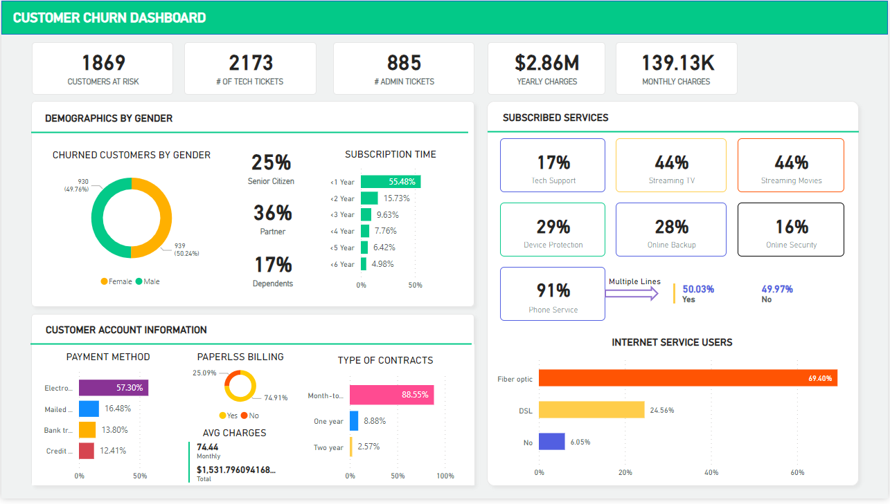
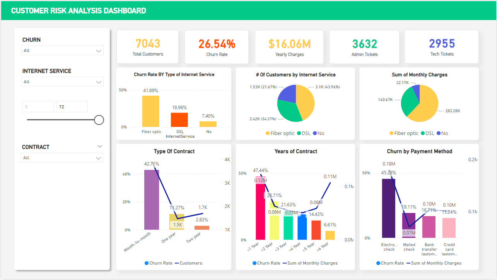

# 📊 Customer Churn Analysis using Power BI

**Author:** Randheer Singh

---

## 🧠 Project Overview

This project focuses on analyzing **customer churn and customer risk** using **Microsoft Power BI**.  
The dashboards provide insights into customer behavior, service usage, billing patterns, and churn drivers to help businesses improve retention strategies.

---

## 🛠 Tools & Technologies

- Microsoft Power BI  
- DAX  
- Power Query  
- Microsoft Excel  

---

## 📊 Dashboards

### 🔹 Customer Churn Dashboard



---

### 🔹 Customer Risk Analysis Dashboard



---

## 📈 Key Insights

- Customers on **month-to-month contracts** have the highest churn rate  
- **Fiber optic internet users** churn more than DSL users  
- **Electronic check** payment method shows higher churn  
- Customers with **shorter tenure** are more likely to churn  
- Higher **monthly charges** increase churn probability  

---

## 📁 Project Structure

```
Customer-Churn-Analysis-using-Power-BI/
│
├── Dataset/
│   └── Customer Churn-Dataset.xlsx
│
├── Dashboards/
│   ├── Customer Churn Dashboard.pbix
│   └── Customer Risk Analysis Dashboard.pbix
│
├── Customer Churn Dashboard.png
├── Customer Risk Analysis.png
└── README.md
```

---

⭐ If you find this project useful, please consider starring the repository!
